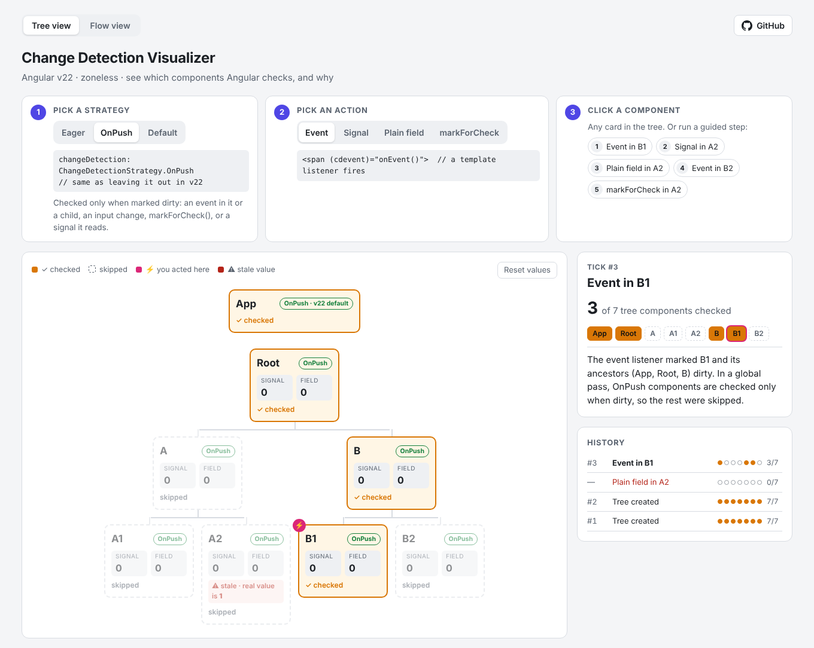
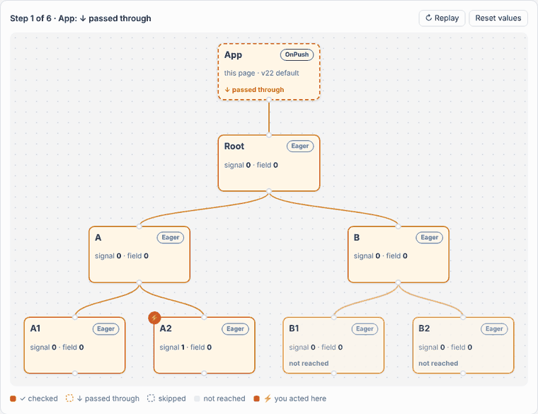

# ng-cd-visualizer

**See which components Angular checks, and why.**

An interactive lab for Angular v22 change detection. Pick a strategy (`Eager`, `OnPush`, `Default`), run an action inside a component, and watch what Angular really does: which components it checks, which it skips, and which ones show stale data.

Everything you see is **measured from real Angular**, not simulated.

**Live demo: [ng-cd-visualizer.vercel.app](https://ng-cd-visualizer.vercel.app)** · [Flow view](https://ng-cd-visualizer.vercel.app/flow)



## Why

Angular v22 changed the defaults:

- New apps are **zoneless**. Nothing re-renders "by magic" after a `setTimeout` anymore.
- **`OnPush` is the default** when you don't set `changeDetection`.
- `ChangeDetectionStrategy.Default` is now a **deprecated alias of `Eager`**. So "Default" no longer means "the default".

These are easy to read about and easy to get wrong. This app lets you try each case and see the result.

## Two pages

### Tree view (`/`)

1. Pick a strategy.
2. Pick an action: **Event**, **Signal**, **Plain field** or **markForCheck**.
3. Click a component, or run one of the guided steps.

After each tick, every card stays marked **✓ checked** or **skipped**. ⚡ marks where you acted. **⚠ stale** shows when a card displays an old value. A side panel explains the tick in one paragraph, and the history keeps one row per tick.

### Flow view (`/flow`)

The same component tree as a node graph. After each tick, the pass is replayed step by step along the edges, in the order Angular checks templates.



Each node ends in one of four states:

| State | Meaning |
| --- | --- |
| **✓ checked** | Angular checked its template. |
| **↓ passed through** | Angular went through it to reach a dirty child, but did not check its template. |
| **skipped** | Angular looked at it and did not check it. |
| **not reached** | Its parent was skipped, so Angular never went down that branch. |

## Getting started

```bash
git clone https://github.com/MeAkib/ng-cd-visualizer.git
cd ng-cd-visualizer
npm install
npm start          # http://localhost:4200
```

Requires Node `^22.22.3 || ^24.15.0 || >=26` (Angular CLI 22 requirement).

## What you will see

Try these in the Tree view. The guided-step buttons run them for you.

| Action | Eager / Default | OnPush |
| --- | --- | --- |
| Event in **B1** | All 7 checked | Only Root → B → B1 |
| Signal in **A2** | Only A2 | Only A2 |
| Plain field in **A2** | Nothing runs. A2 shows a stale value | Nothing runs. A2 shows a stale value |
| …then Event in **B2** | A2 is checked, stale value fixed | A2 still stale |
| markForCheck in **A2** | All 7 checked | Only Root → A → A2 |
| Signal in **B** | B, B1, B2 | Only B |

## Mental model (v22, zoneless)

Change detection is two questions.

**1. When does a tick start?**
Only when Angular is notified: a template event like `(click)`, a change to a signal that a template reads, `markForCheck()`, `setInput()`, the `async` pipe, and so on. There is no zone.js, so `setTimeout` plus a plain field change starts **nothing**.

**2. Which components are checked in that tick?**

- **Global pass** (events, `markForCheck`): Angular walks the tree from the root. `Eager` components are always checked. `OnPush` components are checked only if they are marked dirty.
- **Targeted pass** (only a signal changed): Angular refreshes only the components that read the signal. Their ancestors are passed through, not checked, even `Eager` ones. But refreshing a component is a normal check of its subtree, so its `Eager` children are checked too. This is why "Signal in B" checks B1 and B2 in Eager mode.

| Strategy | Enum value | Behaviour |
| --- | --- | --- |
| `ChangeDetectionStrategy.Eager` | `1` | Checked on every global pass. (The old "Default".) |
| `ChangeDetectionStrategy.OnPush` | `0` | Checked only when dirty. **This is what you get when you leave `changeDetection` out in v22.** |
| `ChangeDetectionStrategy.Default` | `1` | Deprecated alias of `Eager`. Not the same as leaving it out! |

## How the app measures checks

- Each component template has a probe binding: `{{ trackCheck() }}`. Angular evaluates bindings only when it checks that template, so a call means "this component was checked". `ngDoCheck` would be wrong here: it also runs for `OnPush` children that Angular then skips.
- Dev mode runs a second `checkNoChanges` pass in the same tick. The tracker groups all checks in one synchronous run, so each tick counts once.
- The tracker and the animations write to the DOM directly. If they updated a signal, showing a result would start another tick, which would be measured, and so on.
- The app's own controls (and clicking a card) use a plain `addEventListener` (`native-click.ts`), not `(click)`. A `(click)` binding marks the component and its ancestors dirty, which would hide what the action itself does. **This is a trick for this demo only. Don't use it in real apps.**
- The **Event** action dispatches a DOM event to a real template listener, `(cdevent)="onEvent()"`, inside the component. For change detection, that is exactly what a user click on a `(click)` binding does.
- In the Flow view, **checked** is measured. **Passed through**, **skipped** and **not reached** are worked out from the measured result using Angular's traversal rules (`flow-layout.ts`).

## Project structure

```
src/app/
├── app.ts, app.routes.ts   App shell with tabs. The Flow page is lazy loaded (loadComponent).
├── cd-tracker.ts           Records checks per tick. Draws card states, result panel and history.
├── native-click.ts         Click listener that Angular does not know about.
├── tree-data.ts            The tree shape and small helpers.
├── tree-node.ts            Node component in three versions that differ only in `changeDetection`.
├── tree-page.ts            Tree view: controls, layout and guided steps.
├── flow-node.ts            Node component for the Flow view (same base class).
├── flow-layout.ts          Node positions, edge paths, checked/passed/skipped/not-reached rules.
└── flow-page.ts            Flow view: canvas, edges and the step-by-step walk.
```

Built with Angular 22.2, standalone components, signals, zoneless change detection, the new control flow (`@if`, `@for`) and `NgComponentOutlet`.
